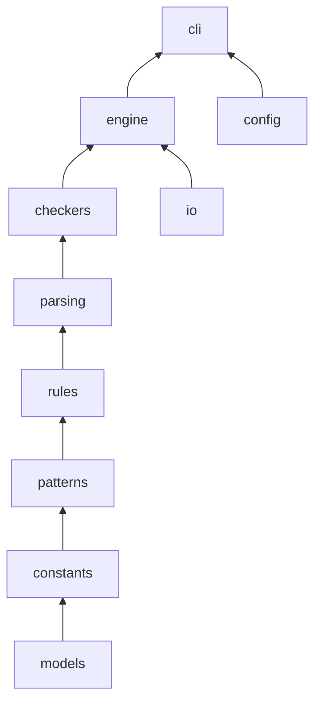

# Blinter Architecture

Blinter is a read-only static analyzer for Windows batch files (`.bat`, `.cmd`). It does not execute batch code; it parses source text and applies rule checkers.

## Module map

```
src/blinter/
  __init__.py          # Public API (library and CLI entry re-exports)
  models.py            # BlinterConfig, LintIssue, Rule, RuleSeverity
  constants.py         # Shared constants (BUILTIN_VARS, MAX_FILE_SIZE_BYTES, ...)
  patterns.py          # Dangerous-command patterns (generated from SSOT)
  rules/
    registry.py        # RULES dict (generated from spec/data/rules.yaml)
    expansion_data.py  # Variable expansion modifiers (generated from batch-spec)
    helpers.py         # _create_rule, _add_issue, severity helpers
  parsing/
    structure.py       # Labels, SET variables, script structure
    context.py         # Comment/safe-context helpers
    embedded.py        # PowerShell/VBScript block detection
  checkers/
    orchestration.py   # _process_file_checks, _filter_issues_by_config
    syntax.py          # Error-level syntax rules
    warnings.py        # Warning-level rules
    warnings_compat.py # Unicode and compatibility warning helpers
    style.py           # Style rules
    security.py        # Security rules
    performance.py     # Performance rules
    vars.py            # Variable rules
    line_endings.py    # Line-ending rules (E018, etc.)
    cmd_extended.py    # Extra cmd.exe syntax, warning, and style checks
    advanced/          # Split from former advanced.py (facade __init__.py)
    globals/           # Split from former globals.py (facade __init__.py)
  engine/
    linter.py          # lint_batch_file() orchestration
    dependencies.py    # CALL graph and cross-script variable collection
  io/
    encoding.py        # read_file_with_encoding, size limits
    discovery.py       # find_batch_files, is_path_under_root
  config/
    loader.py          # blinter.ini loading
  output/
    formatters.py      # CLI output formatting
    json_formatter.py    # JSON report serialization
    sarif_formatter.py   # SARIF 2.1.0 report serialization
  cli/
    args.py            # Argument parsing
    main.py            # CLI orchestration and multi-file processing
```

## Data flow



1. **Input** — `read_file_with_encoding` reads the batch file; encoding is detected via `charset_normalizer` with fallbacks.
2. **Structure** — Labels, SET variables, delayed expansion, and embedded script blocks are analyzed.
3. **Checkers** — Line and global rules run via `orchestration._process_file_checks`.
4. **Filter** — `BlinterConfig`, inline `REM LINT:IGNORE` comments (ASCII case-insensitive), and severity filters apply.
5. **Baseline** — When the CLI is given `--baseline`, `baseline.py` hides findings the file accepts and reports entries that no longer match. `--update-baseline` rewrites the file from the current findings and keeps entries for files that were not scanned.
6. **Output** — `LintIssue` list returned to library callers, or formatted by the CLI as human-readable text (`output/formatters.py`), structured JSON (`output/json_formatter.py` via `--format json` / `--output`), or SARIF 2.1.0 (`output/sarif_formatter.py` via `--format sarif`). JSON adds `baselined_issues` and `stale_baseline_entries` when a baseline is used.

## Public vs internal imports

**Supported public API** (import from `blinter`):

- `lint_batch_file`, `read_file_with_encoding`, `find_batch_files`
- `load_config`, `create_default_config_file`, `main`
- `BlinterConfig`, `LintIssue`, `Rule`, `RuleSeverity`
- `__version__`, `__author__`, `__license__` — the Nuitka exe takes `__version__` from `src/blinter/_build_version.py`, generated at build time from `[project].version`. Source checkouts read that version from `pyproject.toml`, then installed package metadata (`importlib.metadata`), with a final fallback to parsing `pyproject.toml` (see `_version.py`).

**Internal / extension imports** (import from subpackages):

```python
from blinter.rules.registry import RULES
from blinter.checkers.syntax import _check_syntax_errors
from blinter.checkers.advanced import _check_advanced_escaping_rules
from blinter.checkers.globals import _check_unreachable_code
```

Only symbols listed in `blinter.__all__` are stable for external integrators. Checker facades (`blinter.checkers.advanced`, `blinter.checkers.globals`) re-export symbols for tests and advanced use; keep their `__all__` lists in sync when moving functions between submodules.

## Checker refactor (advanced / globals)

Former monolithic modules were split into subpackages with facade `__init__.py` files that re-export all symbols. `orchestration.py` imports from the facades, so call sites do not need deep paths like `blinter.checkers.globals.exit_flow`.

When adding or moving a checker function:

1. Place it in the appropriate submodule under `advanced/` or `globals/`.
2. Add the symbol to that subpackage's `__init__.py` and `__all__`.
3. If `orchestration.py` calls it, ensure the facade export exists.

## Thread safety

`lint_batch_file` and `read_file_with_encoding` are designed for concurrent use: they use local state and immutable global rule metadata. The CLI runs single-threaded. `RULES` is read-only at runtime.

Per-lint invocation-prefix data (subroutine reachability for rules such as SEC014) is stored in a `contextvars.ContextVar` cache that is reset at the start of each `lint_batch_file` call, so concurrent lints in different threads do not share or clear each other's prefix state. Shared `lines_cache` reads and writes are synchronized via a lock in `engine/lines_cache.py`.

## `--follow-calls` and `scan_root`

When `follow_calls` is enabled, Blinter resolves `CALL` targets to read variables and lint called scripts recursively. Variable context is position-aware (available only after each `CALL` line) and includes variables from transitively called scripts within `MAX_FOLLOW_CALL_DEPTH` and `MAX_FOLLOW_CALL_FILES`. The CLI sets `BlinterConfig.scan_root` to the target directory (or the parent of a single file) so paths outside the scan root are not read or processed. `lint_batch_file()` defaults `scan_root` to the batch file's parent directory when unset, matching CLI containment for library callers. Follow-call lint failures on callee scripts are best-effort (logged, no exit impact); skipped primary discovery targets exit with code 1.

## Configuration

`BlinterConfig` controls recursion, rule enablement, `max_line_length`, `follow_calls`, `scan_root`, and severity filtering. Values can be loaded from `blinter.ini` and overridden by CLI flags.

## SSOT split: batch-spec vs Blinter

| Artifact | Repo / path |
|----------|-------------|
| ANTLR grammar, expansion rules, command catalog, cmd-help | [`vendor/batch-spec`](../vendor/batch-spec) ([`BatchLang/batch-spec`](https://github.com/BatchLang/batch-spec), pinned in [`spec/batch-spec.lock`](../spec/batch-spec.lock)) |
| [`spec/data/rules.yaml`](../spec/data/rules.yaml) | Rule catalog (`checker: regex`; see `RULE_COUNT`) |
| [`spec/data/commands-linter.yaml`](../spec/data/commands-linter.yaml) | Security/style command policy (merged with batch-spec `commands.yaml` for `patterns.py`; pins W009 `older_windows_commands`) |
| [`spec/corpus/`](../spec/corpus/) | 294 committed fixtures + `expect.json` oracles |
| [`spec/audit/`](../spec/audit/) | Reference matrix and audit baselines |

Clone with `git clone --recurse-submodules` or run `git submodule update --init --recursive` after checkout.

Generators live under [`scripts/spec/`](../scripts/spec/). `scripts/verify.py` is the quality gate for local runs and CI: schema validation, generator `--check`, strict SSOT audit, lockfile check, formatting, yamllint, mypy, pylint, bandit, pip-audit, the benchmark baseline, pytest, the cmd.exe oracle (Windows), and PowerShell checks (Windows). CI's quality job runs `python scripts/verify.py --skip-pytest` because pytest has its own matrix job. The Windows job runs `python scripts/verify.py --windows-only`.

`patterns.py` `BUILTIN_COMMANDS` is generated as the union of batch-spec `builtin_commands` and
`common_external_tools` so stock Windows utilities and common dev tools both suppress E012/E014.
Deprecated/removed command tables come from batch-spec `commands.yaml` unchanged.

**cmd.exe oracle:** [`scripts/spec/cmd_oracle.py`](../scripts/spec/cmd_oracle.py) runs safe corpus fixtures in isolated `cmd /c` subprocesses. Destructive, interactive, or long-running fixtures remain static-only; skips are listed in [`oracle-skip.yaml`](../spec/corpus/meta/oracle-skip.yaml).

Corpus policy: every rule in `rules.yaml` must have at least one corpus assertion (see `audit_ssot.py` coverage checks).

**Performance gate:** [`scripts/benchmark_lint.py`](../scripts/benchmark_lint.py) with `--check-baseline` compares the synthetic-file median against [`spec/benchmark/synthetic-baseline.json`](../spec/benchmark/synthetic-baseline.json). That absolute CPU-time ceiling is not applied on Intel macOS, which is several times slower than the hosts used to record it. The scaling checks in the same test module still run there.

## Standalone executable

GitHub Actions compiles a Nuitka `--mode=onefile` binary via [`scripts/build_exe.py`](../scripts/build_exe.py). The compile jobs are `test-windows-exe` and `test-unix-exe`. Release jobs only package those smoke-tested binaries; they do not run Nuitka again.

Windows uses `--msvc=latest` (Visual Studio 2022 / MSVC 14.3+, required for Python 3.14). `windows-latest` produces the **Windows x64** executable, and `windows-11-arm` produces the **Windows ARM64** executable. The x64 build also runs on Windows 11 ARM64 through Prism emulation. There is no 32-bit build. [`scripts/test_exe_smoke.py`](../scripts/test_exe_smoke.py) checks the PE Machine field (`0x8664` for x64, `0xAA64` for ARM64), the ELF `e_machine` field, and the Mach-O CPU type, so an x64 executable cannot pass an ARM64 job under emulation.

Linux builds on `ubuntu-24.04` and `ubuntu-24.04-arm`, the oldest GitHub-hosted Ubuntu images that are still supported. The binary needs glibc 2.39 or newer, so it does not run on Ubuntu 22.04. macOS builds on `macos-15` (arm64) and `macos-15-intel` (x64). Those binaries are not Developer ID signed or notarized. Nuitka's ad-hoc signature is enough to launch on Apple Silicon; a browser download can still be blocked by Gatekeeper until quarantine is cleared. There is no universal macOS binary.

The exe venv installs `charset-normalizer` with `--no-binary` so Nuitka compiles the pure-Python package into the binary. CPython still ships native extensions (`python314.dll`, `unicodedata.pyd`, and similar). The bootstrap extracts them to `{CACHE_DIR}/{COMPANY}/{PRODUCT}/{VERSION}` (`%LOCALAPPDATA%\BatchLang\Blinter\<version>\` on Windows, `~/.cache/BatchLang/Blinter/<version>` on Linux, and `~/Library/Caches/BatchLang/Blinter/<version>` on macOS) and loads them from disk. `--file-version` and `--product-version` are passed on every OS so `{VERSION}` is set. The build nofollows unused `ssl`/`socket`/`wmi` modules to keep that payload smaller. The executable is unsigned, so some antivirus ML engines may still flag the extract-then-load pattern.

The build enables LTO, bundles the MSVC runtime DLLs on Windows with `--include-windows-runtime-dlls=yes`, uses `--onefile-cache-mode=cached` for faster relaunch and a stable path for Windows Firewall, and does **not** use UPX. The release publishes:

- `Blinter-vVERSION-Windows-x64.zip` and `Blinter-vVERSION-Windows-arm64.zip`
- `Blinter-vVERSION-Linux-x64.tar.gz` and `Blinter-vVERSION-Linux-arm64.tar.gz`
- `Blinter-vVERSION-macOS-arm64.tar.gz` and `Blinter-vVERSION-macOS-x64.tar.gz`
- `SHA256SUMS` for those archives

Each archive contains a folder of the same name. Windows executables are `blinter.exe`. Linux and macOS executables are `blinter`, with the executable bit stored in the tar. `install_blinter.cmd` remains Windows-only: it requires `x64` or `arm64` and downloads `Blinter-<tag>-Windows-<arch>.zip`. `arm64` is refused on a non-ARM64 PC. On ARM64, `x64` is allowed and runs through Prism emulation. People who already have Python can keep using the PyPI wheel.
